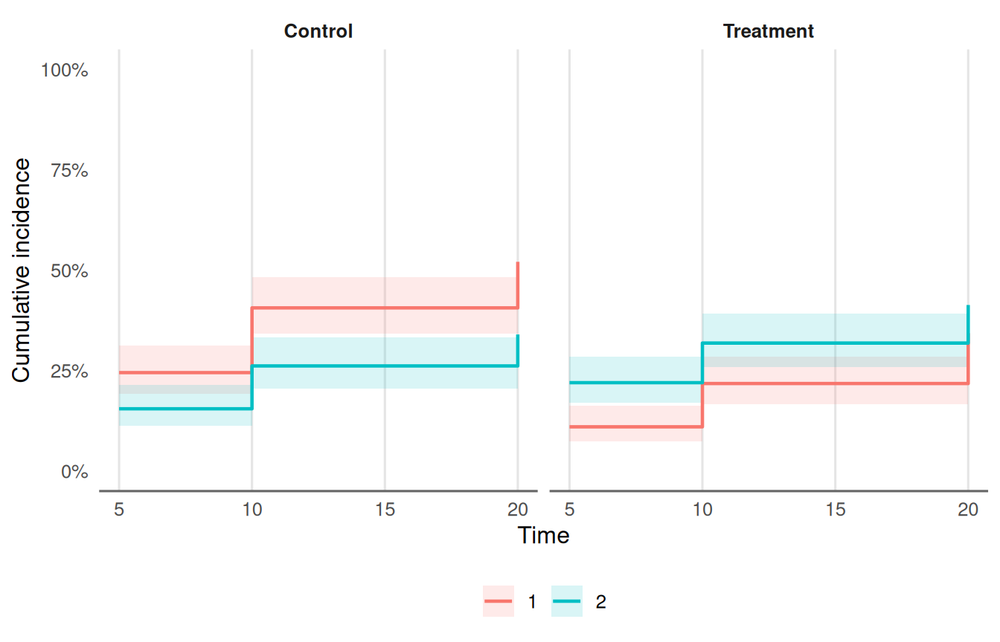

# 08. Proportional Hazards, Competing Risks and Imputation Pooling

This article shows four tools for time-to-event reports: a
proportional-hazards audit, cumulative incidence with competing events,
a Fine-Gray regression, and pooling over multiple imputations. All data
are simulated.

## 1. Is the proportional hazards assumption reasonable?

[`tbl_schoenfeld_audit()`](https://jkylearmstrong.github.io/TempleCBE/reference/tbl_schoenfeld_audit.md)
runs the Schoenfeld-residual test
([`survival::cox.zph()`](https://rdrr.io/pkg/survival/man/cox.zph.html))
for each term and for the model as a whole, and flags terms below
`alpha`.

``` r

fit <- coxph(Surv(time, status) ~ age + sex + ph.ecog, data = lung)
tbl_schoenfeld_audit(fit)
#> # A tibble: 4 × 5
#>   term    chisq    df p.value non_proportional
#>   <chr>   <dbl> <dbl>   <dbl> <lgl>           
#> 1 age     0.188     1   0.665 FALSE           
#> 2 sex     2.31      1   0.129 FALSE           
#> 3 ph.ecog 2.05      1   0.152 FALSE           
#> 4 GLOBAL  4.46      3   0.216 FALSE
```

A small p-value is a prompt to look at the scaled residuals
(`plot(cox.zph(fit))`), not proof of a problem: with many events a
trivial departure is flagged. Typical remedies are a time-varying
coefficient, stratification on the term, or a restricted mean survival
analysis. A tidymodels `workflow` or parsnip `model_fit` that wraps a
`coxph` engine is accepted as well.

## 2. Competing risks: cumulative incidence

When a patient can have more than one kind of event (progression or
death without progression), `1 - Kaplan-Meier` with the other cause
censored overstates the incidence of each. The Aalen-Johansen estimate
does not.

``` r

set.seed(2026)
n <- 400
d <- data.frame(
  id = seq_len(n),
  arm = rep(c("Control", "Treatment"), each = n / 2),
  age = round(rnorm(n, 62, 9))
)
rate1 <- 0.06 * ifelse(d$arm == "Treatment", 0.6, 1) * exp(0.02 * (d$age - 62))
rate2 <- 0.04
t1 <- rexp(n, rate1)
t2 <- rexp(n, rate2)
cens <- runif(n, 5, 30)
d$time <- pmin(t1, t2, cens)
d$type <- ifelse(d$time == cens, 0L, ifelse(d$time == t1, 1L, 2L))
table(d$type, d$arm)
#>    
#>     Control Treatment
#>   0      41        63
#>   1      98        60
#>   2      61        77
```

``` r

cif <- tbl_cumulative_incidence(d, "time", "type", group_col = "arm", times = c(5, 10, 20))
cif
#> # A tibble: 12 × 7
#>    group     cause  time   cif std.error conf.low conf.high
#>    <chr>     <chr> <dbl> <dbl>     <dbl>    <dbl>     <dbl>
#>  1 Control   1         5 0.245    0.0304   0.192      0.312
#>  2 Control   1        10 0.406    0.0357   0.342      0.483
#>  3 Control   1        20 0.521    0.0380   0.452      0.601
#>  4 Control   2         5 0.155    0.0256   0.112      0.214
#>  5 Control   2        10 0.262    0.0320   0.206      0.333
#>  6 Control   2        20 0.340    0.0362   0.276      0.419
#>  7 Treatment 1         5 0.11     0.0221   0.0742     0.163
#>  8 Treatment 1        10 0.218    0.0298   0.167      0.285
#>  9 Treatment 1        20 0.343    0.0384   0.276      0.427
#> 10 Treatment 2         5 0.220    0.0293   0.169      0.286
#> 11 Treatment 2        10 0.319    0.0336   0.259      0.392
#> 12 Treatment 2        20 0.413    0.0378   0.346      0.495
```

``` r

plot_cumulative_incidence(cif, facet = TRUE)
```



Code `1` is the cause of interest and `2` the competing event; `0` is
censoring. The table and plot are descriptive: they do not test or
adjust for anything.

## 3. Competing risks: Fine-Gray regression

[`tbl_fine_gray_single()`](https://jkylearmstrong.github.io/TempleCBE/reference/tbl_fine_gray_single.md)
fits the subdistribution hazard model of one cause for one predictor at
a time (it uses
[`cmprsk::crr()`](https://rdrr.io/pkg/cmprsk/man/crr.html)).

``` r

rbind(
  tbl_fine_gray_single(d, "time", "type", "arm"),
  tbl_fine_gray_single(d, "time", "type", "age")
)
#> # A tibble: 2 × 10
#>   feature term     estimate std.error statistic p.value conf.low conf.high     n
#>   <chr>   <chr>       <dbl>     <dbl>     <dbl>   <dbl>    <dbl>     <dbl> <int>
#> 1 arm     armTrea…    0.516   0.162       -4.09 4.34e-5    0.376     0.709   400
#> 2 age     age         1.02    0.00959      2.47 1.36e-2    1.00      1.04    400
#> # ℹ 1 more variable: n_event <int>
```

The estimate is a **subdistribution hazard ratio**: it speaks about the
cumulative incidence of the cause of interest. It is not the hazard
ratio of a Cox model that censors the competing event, and the two
answer different questions. Report the one that matches the question
(the incidence a patient faces, or the rate among those still at risk),
and say which.

## 4. Pooling multiple imputations

Fit the same model to each of `m` imputed data sets, collect the tidy
results, and pool with Rubin’s rules. Here the imputations are simulated
draws of a covariate with missing values.

``` r

set.seed(7)
lung2 <- na.omit(lung[, c("time", "status", "age", "sex")])
lung2$ph.ecog <- lung$ph.ecog[as.integer(rownames(lung2))]
miss <- is.na(lung2$ph.ecog)
m <- 10
fits <- lapply(seq_len(m), function(i) {
  x <- lung2
  x$ph.ecog[is.na(x$ph.ecog)] <- sample(na.omit(lung2$ph.ecog), sum(miss), replace = TRUE)
  coxph(Surv(time, status) ~ age + sex + ph.ecog, data = x)
})
tidy_fits <- lapply(fits, function(f) {
  s <- summary(f)$coefficients
  data.frame(term = rownames(s), estimate = s[, "coef"], std.error = s[, "se(coef)"])
})
```

[`pool_imputations()`](https://jkylearmstrong.github.io/TempleCBE/reference/pool_imputations.md)
pools each term. Pool on the log hazard ratio scale and use
`exponentiate = TRUE` to report hazard ratios.

``` r

pool_imputations(tidy_fits, exponentiate = TRUE)
#> # A tibble: 3 × 13
#>   term        m estimate std.error within_var   between_var total_var      df
#>   <chr>   <int>    <dbl>     <dbl>      <dbl>         <dbl>     <dbl>   <dbl>
#> 1 age        10    1.01    0.00924  0.0000853 0.00000000623 0.0000853 1.39e 9
#> 2 sex        10    0.571   0.167    0.0281    0.0000000414  0.0281    3.41e12
#> 3 ph.ecog    10    1.59    0.113    0.0128    0.0000397     0.0129    7.79e 5
#> # ℹ 5 more variables: statistic <dbl>, p.value <dbl>, conf.low <dbl>,
#> #   conf.high <dbl>, fmi <dbl>
```

With few observations the large-sample degrees of freedom are too
optimistic. Give the complete-data degrees of freedom (for example
`N - k`) as `df_complete` to get the Barnard-Rubin small-sample
adjustment:

``` r

n_obs <- nrow(lung2)
pool_imputations(tidy_fits, df_complete = n_obs - 3)[, c("term", "df", "p.value", "fmi")]
#> # A tibble: 3 × 4
#>   term       df   p.value     fmi
#>   <chr>   <dbl>     <dbl>   <dbl>
#> 1 age      223. 0.242     0.00893
#> 2 sex      223. 0.000976  0.00885
#> 3 ph.ecog  222. 0.0000612 0.0122
```

A term that is missing from any imputation is an error, not a silent
drop.

### Model-level fit

[`glance_imputations()`](https://jkylearmstrong.github.io/TempleCBE/reference/glance_imputations.md)
pools the one-row summaries
([`broom::glance()`](https://generics.r-lib.org/reference/glance.html)
output) in the same way: the mean over the imputations with its spread,
and, where the glance has a `std.error.<statistic>` column (such as the
concordance), a Rubin standard error and interval.

``` r

glances <- lapply(fits, function(f) {
  s <- summary(f)
  data.frame(concordance = unname(s$concordance[1]),
             std.error.concordance = unname(s$concordance[2]),
             logLik = f$loglik[2])
})
glance_imputations(glances)
#> # A tibble: 2 × 10
#>   statistic       m estimate between_sd      min      max std.error conf.low
#>   <chr>       <int>    <dbl>      <dbl>    <dbl>    <dbl>     <dbl>    <dbl>
#> 1 concordance    10    0.637    0.00159    0.634    0.640    0.0250    0.588
#> 2 logLik         10 -734.       0.230   -735.    -734.      NA        NA    
#> # ℹ 2 more variables: conf.high <dbl>, fmi <dbl>
```

The pooled concordance is the mean of C-indices from separately
completed data sets, not the C-index of a pooled model.
