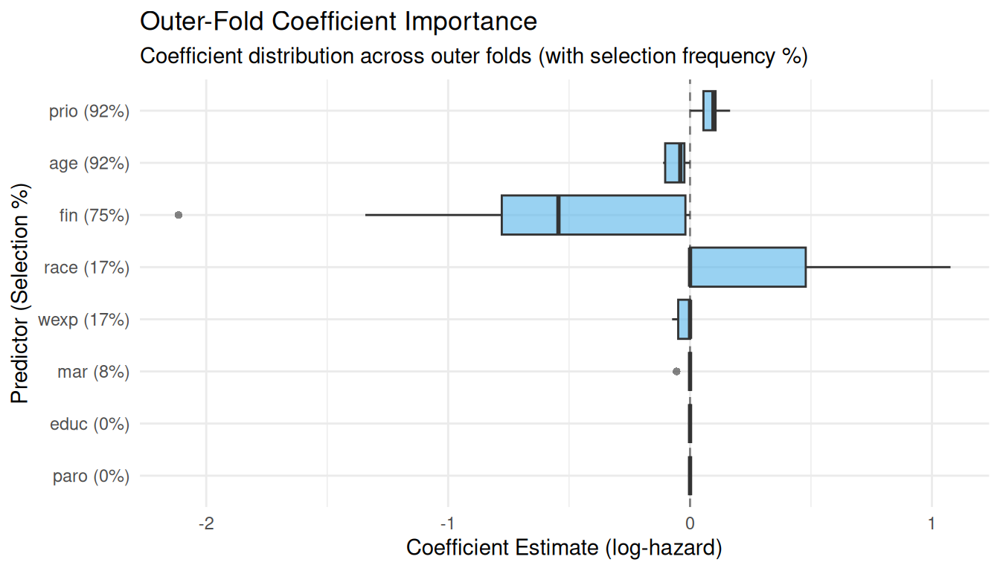

# 08. End-to-End Nested Survival Run and Multi-Machine Sharding on Rossi Data

## Overview

In multi-domain clinical survival pipelines, each domain report
traditionally strings together ~150 lines of boilerplate:

1.  **Validate counting-process intervals**
    ([`validate_start_stop()`](https://jkylearmstrong.github.io/TempleCBE/reference/validate_start_stop.md))
2.  **Construct subject-grouped nested folds**
    ([`rsample::nested_cv()`](https://rsample.tidymodels.org/reference/nested_cv.html) +
    [`rsample::group_vfold_cv()`](https://rsample.tidymodels.org/reference/group_vfold_cv.html))
3.  **Inner hyperparameter tuning**
    ([`tune_alpha_by_split()`](https://jkylearmstrong.github.io/TempleCBE/reference/tune_alpha_by_split.md))
4.  **Candidate model selection**
    ([`select_candidate_models()`](https://jkylearmstrong.github.io/TempleCBE/reference/select_candidate_models.md))
5.  **Outer-fold scoring**
    ([`score_outer()`](https://jkylearmstrong.github.io/TempleCBE/reference/score_outer.md))
6.  **Predictor importance & selection stability**
    ([`summarize_outer_importance()`](https://jkylearmstrong.github.io/TempleCBE/reference/summarize_outer_importance.md))
7.  **Censoring weight sensitivity comparison**
    ([`compare_censoring_weights()`](https://jkylearmstrong.github.io/TempleCBE/reference/compare_censoring_weights.md))

This vignette demonstrates how to run the entire nested survival
workflow on the packaged
[`rossi_data()`](https://jkylearmstrong.github.io/TempleCBE/reference/rossi_data.md)
recidivism cohort:

- **One-call execution** with
  [`nested_survival_run()`](https://jkylearmstrong.github.io/TempleCBE/reference/nested_survival_run.md)
  (including [`summary()`](https://rdrr.io/r/base/summary.html),
  [`plot()`](https://rdrr.io/r/graphics/plot.default.html), and
  [`tidy()`](https://generics.r-lib.org/reference/tidy.html) methods)
- **Sharding across machines** with `shard = c(1, 2)` and
  `shard = c(2, 2)`, merging completed shards with
  [`collect_checkpoints()`](https://jkylearmstrong.github.io/TempleCBE/reference/collect_checkpoints.md),
  and pruning stale checkpoints with
  [`clean_checkpoints()`](https://jkylearmstrong.github.io/TempleCBE/reference/clean_checkpoints.md)
- **Self-rendering reproducibility appendix** via
  [`repro_appendix()`](https://jkylearmstrong.github.io/TempleCBE/reference/repro_appendix.md)

``` r

library(TempleCBE)
library(recipes)
library(rsample)
library(survival)
library(dplyr)
```

------------------------------------------------------------------------

## 1. Preparing `rossi_data()` in Start/Stop Format

The packaged
[`rossi_data()`](https://jkylearmstrong.github.io/TempleCBE/reference/rossi_data.md)
dataset tracks 432 individuals over a 52-week follow-up window with
baseline covariates (`fin`, `age`, `race`, `wexp`, `mar`, `paro`,
`prio`, `educ`) and weekly employment indicators (`emp1`–`emp52`).

For a fast, self-contained demonstration, we convert a 90-subject subset
of
[`rossi_data()`](https://jkylearmstrong.github.io/TempleCBE/reference/rossi_data.md)
into counting-process `(tstart, tstop, status)` intervals and run
[`validate_start_stop()`](https://jkylearmstrong.github.io/TempleCBE/reference/validate_start_stop.md)
to verify interval integrity and censoring rate:

``` r

raw_rossi <- rossi_data()

# Construct counting-process (tstart, tstop, status) intervals per subject
rossi_cohort <- raw_rossi |>
  slice(1:90) |>
  mutate(
    id = row_number(),
    tstart = 0,
    tstop = as.numeric(week),
    status = as.integer(arrest)
  ) |>
  select(id, tstart, tstop, status, fin, age, race, wexp, mar, paro, prio, educ)

val <- validate_start_stop(
  rossi_cohort,
  id = "id",
  start = "tstart",
  stop = "tstop",
  status = "status"
)
val
#> TempleCBE Start/Stop Survival Data Check
#> ----------------------------------------
#> Subjects:               90 (21 with event, 69 censored [76.7%])
#> Intervals (rows):       90 (events: 21, missing: 0)
#> Overlapping intervals:  0
#> Gapped intervals:       0
#> Events before last row: 0
#> Rows after an event:    0
#> Non-positive intervals: 0
#> Tied times:             72 stop time(s), 3 event time(s)
#> Status:                 VALID
```

------------------------------------------------------------------------

## 2. One-Call Nested Survival Run (`nested_survival_run()`)

[`nested_survival_run()`](https://jkylearmstrong.github.io/TempleCBE/reference/nested_survival_run.md)
executes all seven stages in order, writes fingerprinted checkpoints and
`render_manifest.json` into `run_dir`, and resumes automatically if
rerun with identical data and settings:

``` r

run_dir <- file.path(tempdir(), "rossi_e1_run")

rec <- recipe(~ ., data = rossi_cohort) |>
  update_role(id, tstart, tstop, status, new_role = "id variable")

features <- c("fin", "age", "race", "wexp", "mar", "paro", "prio", "educ")
candidate_formulas <- c(
  "fin + age + prio",
  "fin + age + race + wexp + mar + paro + prio + educ"
)

rossi_run <- nested_survival_run(
  data = rossi_cohort,
  recipe = rec,
  id = "id",
  start = "tstart",
  stop = "tstop",
  status = "status",
  domain = "Recidivism",
  run_dir = run_dir,
  feature_names = features,
  formulas = candidate_formulas,
  outer_v = 3,
  inner_v = 3,
  alphas = c(0.2, 0.5, 0.8),
  top_n = 2,
  internal_folds = 3,
  cox.ties = "breslow",
  seed = 67025
)

rossi_run
#> <cbe_nested_survival_run> Domain: Recidivism [completed]
#>   Subjects: 90 (Events: 21, Censored: 69 [76.7%])
#>   Outer folds: 3 | Candidate models: 4 | Outer fits: 12
#>   Median outer IBS: 0.0714 (IQR: 0.0521) | Seed: 67025 (v0.5.6)
#>   Run directory: /tmp/RtmpDkihtV/rossi_e1_run (fingerprint: ceaf46f7225d)
```

### Inspecting Results with `summary()`, `tidy()`, and `plot()`

``` r

summary(rossi_run)
#> Summary: Nested Survival Run (Domain: Recidivism)
#> --------------------------------------------------
#> Cohort:       90 subjects (21 events, 69 censored)
#> Best model:   alpha=0.2; fin + age + prio (alpha = 0.200)
#> Outer IBS:    median = 0.0714, mean = 0.0862
#> IPCW vs None: Spearman = 1.000, Kendall = 1.000
#> 
#> Top Predictors by Outer-Fold Selection Frequency:
#> # A tibble: 8 × 4
#>   term  label selection_freq median_estimate
#>   <chr> <chr>          <dbl>           <dbl>
#> 1 prio  prio           0.917          0.0968
#> 2 age   age            0.917         -0.0403
#> 3 fin   fin            0.75          -0.544 
#> 4 race  race           0.167          0     
#> 5 wexp  wexp           0.167          0     
#> # ℹ 3 more rows

# Tidy extractor supports "importance", "outer_scores", "candidates", "tuning", "censoring", "validation"
 generics::tidy(rossi_run, component = "importance")
#> # A tibble: 8 × 13
#>   term  label n_models n_selected selection_freq median_estimate mean_estimate
#>   <chr> <chr>    <int>      <int>          <dbl>           <dbl>         <dbl>
#> 1 prio  prio        12         11         0.917           0.0968       0.0871 
#> 2 age   age         12         11         0.917          -0.0403      -0.0532 
#> 3 fin   fin         12          9         0.75           -0.544       -0.576  
#> 4 race  race        12          2         0.167           0            0.143  
#> 5 wexp  wexp        12          2         0.167           0           -0.0116 
#> 6 mar   mar         12          1         0.0833          0           -0.00463
#> 7 educ  educ        12          0         0               0            0      
#> 8 paro  paro        12          0         0               0            0      
#> # ℹ 6 more variables: min_estimate <dbl>, max_estimate <dbl>,
#> #   range_estimate <dbl>, q25_estimate <dbl>, q75_estimate <dbl>,
#> #   iqr_estimate <dbl>
 generics::tidy(rossi_run, component = "censoring")
#> # A tibble: 12 × 9
#>    outer_fold model          alpha formula ibs_none ibs_ipcw rank_none rank_ipcw
#>    <chr>      <chr>          <dbl> <chr>      <dbl>    <dbl>     <int>     <int>
#>  1 Resample1  alpha=0.2; fi…   0.2 fin + …   0.0648   0.0648         1         1
#>  2 Resample1  alpha=0.5; fi…   0.5 fin + …   0.0648   0.0648         2         2
#>  3 Resample1  alpha=0.2; fi…   0.2 fin + …   0.0809   0.0809         4         4
#>  4 Resample1  alpha=0.5; fi…   0.5 fin + …   0.0733   0.0733         3         3
#>  5 Resample2  alpha=0.2; fi…   0.2 fin + …   0.0647   0.0647         2         2
#>  6 Resample2  alpha=0.5; fi…   0.5 fin + …   0.0584   0.0584         1         1
#>  7 Resample2  alpha=0.2; fi…   0.2 fin + …   0.0696   0.0696         4         4
#>  8 Resample2  alpha=0.5; fi…   0.5 fin + …   0.0681   0.0681         3         3
#>  9 Resample3  alpha=0.2; fi…   0.2 fin + …   0.115    0.115          1         1
#> 10 Resample3  alpha=0.5; fi…   0.5 fin + …   0.127    0.127          4         4
#> 11 Resample3  alpha=0.2; fi…   0.2 fin + …   0.125    0.125          3         3
#> 12 Resample3  alpha=0.5; fi…   0.5 fin + …   0.124    0.124          2         2
#> # ℹ 1 more variable: rank_diff <int>

plot(rossi_run, type = "importance")
```



------------------------------------------------------------------------

## 3. Sharding Across Machines and Merging with `collect_checkpoints()`

When a tuning or outer-scoring grid spans multiple outer folds and
domains, work can be split across `n` machines sharing a network drive
(or synced checkpoint directory) using `shard = c(i, n)`:

- **Machine 1** runs `shard = c(1, 2)`
- **Machine 2** runs `shard = c(2, 2)`
- Once all shards finish,
  [`collect_checkpoints()`](https://jkylearmstrong.github.io/TempleCBE/reference/collect_checkpoints.md)
  verifies that every checkpoint file shares the same
  `checkpoint_run_fingerprint` and `seed_scheme` (`"v0.5.6"`) and binds
  them into a single table identical to a single-machine run.

### Step-by-Step Sharded Tuning & Outer Scoring

``` r

shard_dir <- file.path(tempdir(), "rossi_sharded_checkpoints")
tune_ckpt_dir <- file.path(shard_dir, "tune_fold1")
score_ckpt_dir <- file.path(shard_dir, "score_outer")

# the fold assignment is random: without a seed a build occasionally drew a fold without events
set.seed(67025)
nested_splits <- nested_cv(
  rossi_cohort,
  outside = group_vfold_cv(group = id, v = 2),
  inside = group_vfold_cv(group = id, v = 2)
)
times_df <- unique(rossi_cohort[, c("tstart", "tstop")])

# --- Machine 1 evaluates Shard 1 of 2 ---
tune_shard_1 <- tune_alpha_by_split(
  object = nested_splits$inner_resamples[[1]],
  recipe = rec,
  feature_names = features,
  alphas = c(0.25, 0.75),
  time_data = times_df,
  internal_folds = 3,
  cox.ties = "breslow",
  checkpoint_dir = tune_ckpt_dir,
  shard = c(1, 2),
  seed = 67025
)

# --- Machine 2 evaluates Shard 2 of 2 ---
tune_shard_2 <- tune_alpha_by_split(
  object = nested_splits$inner_resamples[[1]],
  recipe = rec,
  feature_names = features,
  alphas = c(0.25, 0.75),
  time_data = times_df,
  internal_folds = 3,
  cox.ties = "breslow",
  checkpoint_dir = tune_ckpt_dir,
  shard = c(2, 2),
  seed = 67025
)

# --- Merge shards with collect_checkpoints() ---
merged_tune <- collect_checkpoints(tune_ckpt_dir, type = "tune")
merged_tune
#> # A tibble: 32 × 6
#>    inner_resamples_splits    IBS lambda term  estimate alpha
#>    <chr>                   <dbl>  <dbl> <chr>    <dbl> <dbl>
#>  1 1                      0.0803  0.753 fin          0  0.25
#>  2 1                      0.0803  0.753 age          0  0.25
#>  3 1                      0.0803  0.753 race         0  0.25
#>  4 1                      0.0803  0.753 wexp         0  0.25
#>  5 1                      0.0803  0.753 mar          0  0.25
#>  6 1                      0.0803  0.753 paro         0  0.25
#>  7 1                      0.0803  0.753 prio         0  0.25
#>  8 1                      0.0803  0.753 educ         0  0.25
#>  9 1                      0.0803  0.251 fin          0  0.75
#> 10 1                      0.0803  0.251 age          0  0.75
#> # ℹ 22 more rows

# Select candidate models from merged tuning results
cand_grid <- select_candidate_models(
  merged_tune,
  formulas = candidate_formulas,
  top_n = 2
)
cand_grid
#> # A tibble: 4 × 3
#>   model                                                          alpha formula  
#>   <chr>                                                          <dbl> <chr>    
#> 1 alpha=0.25; fin + age + prio                                    0.25 fin + ag…
#> 2 alpha=0.75; fin + age + prio                                    0.75 fin + ag…
#> 3 alpha=0.25; fin + age + race + wexp + mar + paro + prio + educ  0.25 fin + ag…
#> 4 alpha=0.75; fin + age + race + wexp + mar + paro + prio + educ  0.75 fin + ag…
```

Now we shard outer-fold evaluation
([`score_outer()`](https://jkylearmstrong.github.io/TempleCBE/reference/score_outer.md))
across two machines and merge the results:

``` r

# Machine 1: Shard 1 of 2
score_outer(
  object = nested_splits,
  grid = cand_grid,
  recipe = rec,
  feature_names = features,
  time_data = times_df,
  internal_folds = 3,
  cox.ties = "breslow",
  checkpoint_dir = score_ckpt_dir,
  shard = c(1, 2),
  seed = 67025
)
#> # A tibble: 4 × 7
#>   outer_fold model                      alpha formula    IBS lambda coefficients
#>   <chr>      <chr>                      <dbl> <chr>    <dbl>  <dbl> <list>      
#> 1 Resample1  alpha=0.25; fin + age + p…  0.25 fin + … 0.0850 0.0188 <tibble>    
#> 2 Resample1  alpha=0.25; fin + age + r…  0.25 fin + … 0.0841 0.132  <tibble>    
#> 3 Resample2  alpha=0.25; fin + age + p…  0.25 fin + … 0.0960 0.510  <tibble>    
#> 4 Resample2  alpha=0.25; fin + age + r…  0.25 fin + … 0.0960 0.510  <tibble>

# Machine 2: Shard 2 of 2
score_outer(
  object = nested_splits,
  grid = cand_grid,
  recipe = rec,
  feature_names = features,
  time_data = times_df,
  internal_folds = 3,
  cox.ties = "breslow",
  checkpoint_dir = score_ckpt_dir,
  shard = c(2, 2),
  seed = 67025
)
#> # A tibble: 4 × 7
#>   outer_fold model                     alpha formula    IBS  lambda coefficients
#>   <chr>      <chr>                     <dbl> <chr>    <dbl>   <dbl> <list>      
#> 1 Resample1  alpha=0.75; fin + age + …  0.75 fin + … 0.0861 0.00170 <tibble>    
#> 2 Resample1  alpha=0.75; fin + age + …  0.75 fin + … 0.0850 0.0583  <tibble>    
#> 3 Resample2  alpha=0.75; fin + age + …  0.75 fin + … 0.0960 0.170   <tibble>    
#> 4 Resample2  alpha=0.75; fin + age + …  0.75 fin + … 0.0960 0.170   <tibble>

# Merge outer-fold checkpoints
merged_outer <- collect_checkpoints(score_ckpt_dir, type = "score_outer")
merged_outer
#> # A tibble: 8 × 7
#>   outer_fold model                     alpha formula    IBS  lambda coefficients
#>   <chr>      <chr>                     <dbl> <chr>    <dbl>   <dbl> <list>      
#> 1 Resample1  alpha=0.25; fin + age + …  0.25 fin + … 0.0850 0.0188  <tibble>    
#> 2 Resample1  alpha=0.75; fin + age + …  0.75 fin + … 0.0861 0.00170 <tibble>    
#> 3 Resample1  alpha=0.25; fin + age + …  0.25 fin + … 0.0841 0.132   <tibble>    
#> 4 Resample1  alpha=0.75; fin + age + …  0.75 fin + … 0.0850 0.0583  <tibble>    
#> 5 Resample2  alpha=0.25; fin + age + …  0.25 fin + … 0.0960 0.510   <tibble>    
#> 6 Resample2  alpha=0.75; fin + age + …  0.75 fin + … 0.0960 0.170   <tibble>    
#> 7 Resample2  alpha=0.25; fin + age + …  0.25 fin + … 0.0960 0.510   <tibble>    
#> 8 Resample2  alpha=0.75; fin + age + …  0.75 fin + … 0.0960 0.170   <tibble>

# Summarize predictor importance across outer folds
summarize_outer_importance(merged_outer)
#> # A tibble: 8 × 13
#>   term  label n_models n_selected selection_freq median_estimate mean_estimate
#>   <chr> <chr>    <int>      <int>          <dbl>           <dbl>         <dbl>
#> 1 fin   fin          8          4            0.5         -0.156        -0.271 
#> 2 age   age          8          4            0.5         -0.0477       -0.102 
#> 3 prio  prio         8          4            0.5          0.0454        0.0600
#> 4 educ  educ         8          0            0            0             0     
#> 5 mar   mar          8          0            0            0             0     
#> 6 paro  paro         8          0            0            0             0     
#> 7 race  race         8          0            0            0             0     
#> 8 wexp  wexp         8          0            0            0             0     
#> # ℹ 6 more variables: min_estimate <dbl>, max_estimate <dbl>,
#> #   range_estimate <dbl>, q25_estimate <dbl>, q75_estimate <dbl>,
#> #   iqr_estimate <dbl>
```

### Cleaning Up Old Checkpoints (`clean_checkpoints()`)

If inputs or settings change in a subsequent run,
`clean_checkpoints(dir, keep = "current")` inspects all checkpoint
`.rds` files and removes superseded or mismatched files while preserving
the active run’s checkpoints:

``` r

clean_checkpoints(score_ckpt_dir, keep = "current", dry_run = TRUE)
#> TempleCBE Checkpoint Cleanup
#> ----------------------------
#> Kept:    8 file(s)
#> Removed: 0 file(s) (dry run)
```

------------------------------------------------------------------------

## 4. Self-Rendering Reproducibility Appendix (`repro_appendix()`)

Every report can end with
[`repro_appendix()`](https://jkylearmstrong.github.io/TempleCBE/reference/repro_appendix.md),
which records package versions, git commit, RNG seed, `seed_scheme`,
active
[`future::plan()`](https://future.futureverse.org/reference/plan.html),
dataset SHA-256 hashes,
[`validate_start_stop()`](https://jkylearmstrong.github.io/TempleCBE/reference/validate_start_stop.md)
results, checkpoint fingerprints, and the render manifest:

``` r

repro_appendix(run = rossi_run, heading_level = 3)
```

### Reproducibility Appendix

#### Environment & Execution Metadata

| Field | Value |
|:---|:---|
| **R Version** | `R version 4.6.2 (2026-10-29)` (x86_64-pc-linux-gnu) |
| **TempleCBE Version** | `0.7.9` |
| **Git Commit (Branch)** | `5b9591bb873f` (`HEAD`) |
| **RNG Seed** | `67025` |
| **Seed Scheme** | `v0.5.6` |
| **Future Plan** | `FutureStrategy/sequential/uniprocess/future/function` (1 worker(s)) |
| **Manifest Timestamp** | `2026-10-29T19:20:24Z` |

#### Package Versions

| Package     | Version  |
|:------------|:---------|
| `TempleCBE` | `0.7.9`  |
| `survival`  | `3.8.12` |
| `glmnet`    | `5.2`    |
| `recipes`   | `1.4.0`  |
| `rsample`   | `1.3.2`  |
| `yardstick` | `1.4.0`  |
| `furrr`     | `0.4.0`  |
| `future`    | `1.80.0` |
| `quarto`    | `1.5.1`  |
| `rmarkdown` | `2.32`   |
| `renv`      | `1.2.4`  |

#### Data Content Hashes (SHA-256)

| Dataset | Rows | Cols | SHA-256 |
|:---|---:|---:|:---|
| `run:Recidivism` | 90 | 12 | `9feea731c588dcc6db4ad973d87aab0e25cc17832db002a9ae4db801f2999b40` |

#### Counting-Process Validation (`validate_start_stop()`)

| Subjects | Intervals | Events | Censored | Censoring Rate | Valid |
|---------:|----------:|-------:|---------:|---------------:|:------|
|       90 |        90 |     21 |       69 |          76.7% | PASS  |

#### Checkpoint Fingerprints

| Source | Family | Files | Fingerprint | Seed Scheme |
|:---|:---|---:|:---|:---|
| `run:Recidivism` | `cbe_nested_survival_run` | \- | `ceaf46f7225dee09af3c647d0e829a2c5f218f57eb44732c1461f63c0d5eb26c` | `v0.5.6` |
| `rossi_e1_run` | `checkpoint` | 1 | `NA` | `NA` |
| `rossi_e1_run` | `nested_survival_run_score_outer` | 2 | `ceaf46f7225dee09af3c647d0e829a2c5f218f57eb44732c1461f63c0d5eb26c` | `v0.5.6` |
| `rossi_e1_run` | `tune` | 3 | `ceaf46f7225dee09af3c647d0e829a2c5f218f57eb44732c1461f63c0d5eb26c` | `v0.5.6` |
